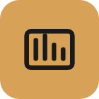
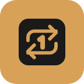
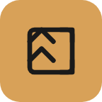
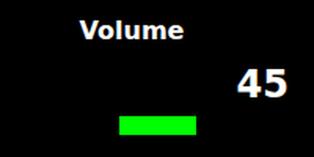
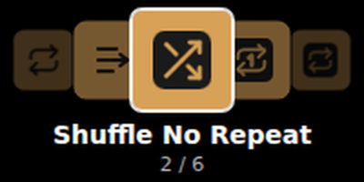
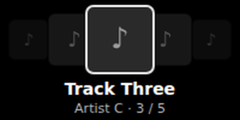
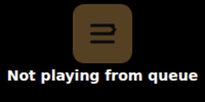

# Sonos Controller for Stream Deck

Control Sonos speakers directly from your Elgato Stream Deck. Communicates over UPnP/SOAP on your local LAN — no cloud, no Sonos account required. Requires Stream Deck software 6.5+ and macOS 10.11+ or Windows 10+.

## Actions

Every action is bound to one speaker, chosen in the action's settings. Keys work on any Stream
Deck; dials need a Stream Deck +. **Icon** is what you drag from the action list in the Stream
Deck app; **States** are the images the key can show.

### Keys

| Icon | Key | States | Press | Shows | Settings |
|---|---|---|---|---|---|
|  | Currently Playing |  | Refreshes the speaker's state | Album art with a scrolling title | Album art, scrolling title |
|  | Toggle Play/Pause |    | Play or pause | Paused, playing or stopped; album art if enabled | Album art, scrolling album title, state title |
|  | Toggle Mute |   | Mute or unmute | Unmuted or muted | State title |
|  | Toggle Play Mode |       | Next shuffle/repeat mode | Normal, shuffle (no repeat), shuffle (repeat one), shuffle (repeat all), repeat one, repeat all | Which modes to cycle through |
|  | Toggle Input Source |    | Next source | Sonos Queue, TV or Line-In | Which sources to cycle through |
|  | Play Previous Track |  | Previous track in the queue |  |  |
|  | Play Next Track |  | Next track in the queue |  |  |
|  | Volume Down |  | Lowers the volume |  | Volume step |
|  | Volume Up |  | Raises the volume |  | Volume step |
|  | Play Sonos Favorite |  | Clears the queue and plays the chosen favorite |  | Favorite |

### Dials (Stream Deck +)

Each dial draws on its part of the touch strip.

| Icon | Dial | Turn | Push | Tap the strip | Settings |
|---|---|---|---|---|---|
|  | Audio Equalizer | Adjusts Volume, Bass or Treble | Mute, play/pause, next track or nothing | Re-reads volume, bass and treble | Which level to adjust; what push does |
|  | Play Mode Dial | Slides through the shuffle/repeat modes; applied when you stop turning | Next mode now | Next mode now | Which modes appear |
|  | Queue Track Dial | Slides through the current queue (art, title, artist, position); plays the track when you stop turning; wraps at both ends | Next track now | Next track now | |

On the touch strip (the Queue Track Dial shows **Not playing from queue** and does nothing while
the speaker plays radio, TV or line-in):

<table>
  <tr>
    <td align="center"> Audio Equalizer</td>
    <td align="center"> Play Mode Dial</td>
  </tr>
  <tr>
    <td align="center"> Queue Track Dial</td>
    <td align="center"> Queue Track Dial, not on the queue</td>
  </tr>
</table>

## First-run setup

1. Install the plugin by double-clicking the `.streamDeckPlugin` file from a GitHub Release.
2. Drag any Sonos action onto a key on your Stream Deck.
3. The plugin prompt appears: enter your **Primary Device Address (Discovery)** — e.g., `192.168.1.42` (the IP of any Sonos speaker on your network; find it in the Sonos app under Settings → System → About My System).
4. Tap **Save and Connect**. Your household is discovered, the speaker dropdown populates, and the discovery speaker becomes the default bind for new actions.

## Local development

1. Clone the repo: `git clone https://github.com/r-teller/streamdeck-sonoscontroller.git`
2. Install dependencies: `npm install`
3. Build and validate: `npm run build_dev_incr && npm run validate`
4. Side-load the plugin:
   - macOS: `ln -s "$(pwd)/com.r-teller.sonoscontroller.sdPlugin" ~/Library/Application\ Support/com.elgato.StreamDeck/Plugins/com.r-teller.sonoscontroller.sdPlugin`
   - Windows: `mklink /J "%APPDATA%\Elgato\StreamDeck\Plugins\com.r-teller.sonoscontroller.sdPlugin" "%CD%\com.r-teller.sonoscontroller.sdPlugin"`
   - Or use `streamdeck link` if `@elgato/cli` is globally installed.
5. Restart the Stream Deck app to reload the plugin.  
   Note: There is no hot reload — rebuild and restart to pick up changes. The manifest enables Node.js debugging for the plugin background; the PI webview has its own devtools via the Stream Deck app’s debug mode.

## Testing

- `npm test` runs the Vitest unit suite.
- `npm run test:pw` runs Playwright end-to-end scenarios against a mocked Stream Deck host and mocked Sonos household (`tests/playwright/support/mockStreamDeckHost.js`, `mockSonos.js`) with committed screenshot baselines under `tests/playwright/screenshots/`. Run `npm run build_dev` before `test:pw`.
- Lint and format checks: `npm run lint` and `npm run format:check`.

## Packaging

Build and package locally with:  
`npm run build && npm run package`  
This produces `com.r-teller.sonoscontroller.streamDeckPlugin` in the repo root.

Releases are built by CI when a GitHub release is published; it stamps the version from the tag and attaches the plugin file. See [docs/releases.md](docs/releases.md) for version numbers (betas `x.y.z.n`, final `x.y.z`) and steps.

## License

MIT
